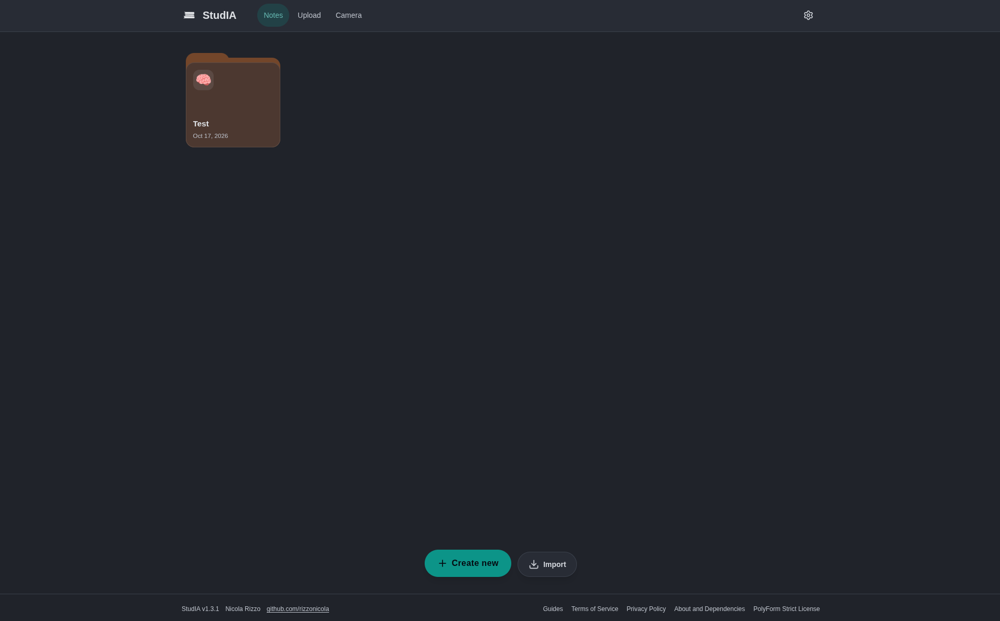
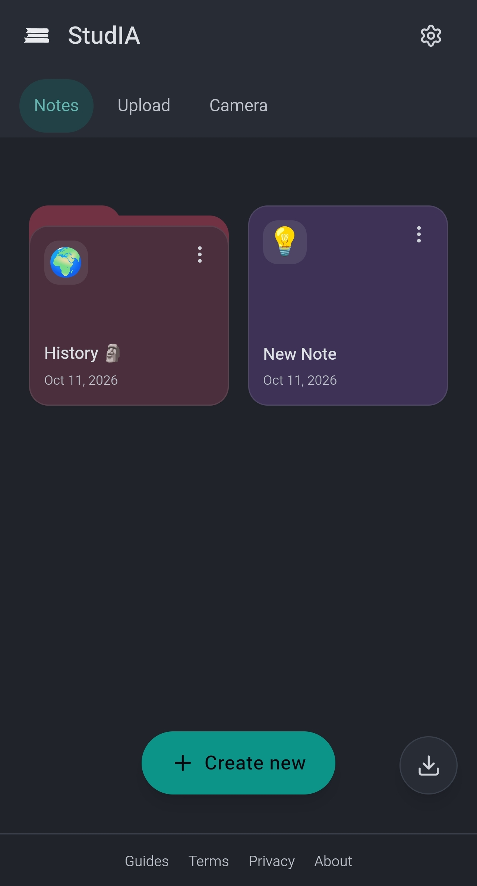

<p align="center">
  
</p>

<h1 align="center">StudIA</h1>

<p align="center">
  Appunti, quiz e mappe concettuali con l'AI.<br>
  Trasforma PDF, foto e lezioni registrate in materiale di studio con Google Gemini.
</p>

<p align="center">
  <a href="https://studia.poppi.cc"><strong>Apri l'app → studia.poppi.cc</strong></a>
</p>

<p align="center">
  
  &nbsp;
  
</p>

## Cosa fa

- **Appunti** da PDF, foto, audio e video.
- **Quiz** con spiegazioni, per ripassare.
- **Mappe concettuali** dei tuoi appunti.
- **Cartelle**, importazione ed esportazione dei tuoi materiali.
- **Temi** chiari e scuri, personalizzabili.
- **Italiano, English, Français.**

## Privacy

Nessun account e nessun server: gli appunti restano nel tuo browser e usi la tua chiave API gratuita di [Google AI Studio](https://aistudio.google.com/), salvata solo sul tuo dispositivo.

## Installazione

StudIA è una PWA: si può installare da Chrome, Edge, Samsung Internet e Brave, oppure da Safari su iPhone/iPad dal menu *Condividi*. Anche senza connessione l'app si apre e gli appunti già salvati restano consultabili; per generarne di nuovi serve la rete.

## Per sviluppatori

```bash
npm install
npm run dev     # http://localhost:3000
npm test
npm run build   # output in dist/
```

Stack: Vite, React, TypeScript, Tailwind, IndexedDB. Note tecniche (deploy, SEO, PWA, temi, modelli): [`docs/SVILUPPO.md`](docs/SVILUPPO.md).

## Autore e licenza

Progetto di [Nicola Rizzo](https://github.com/rizzonicola), con licenza [PolyForm Strict 1.0.0](LICENSE): uso non commerciale consentito, nessun diritto di distribuzione o modifica. Il codice è visibile (*source-available*) ma non è open source in senso OSI.
